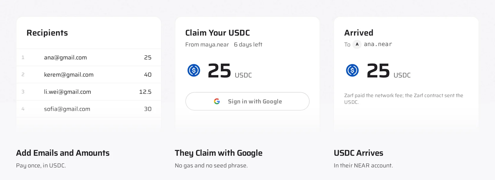
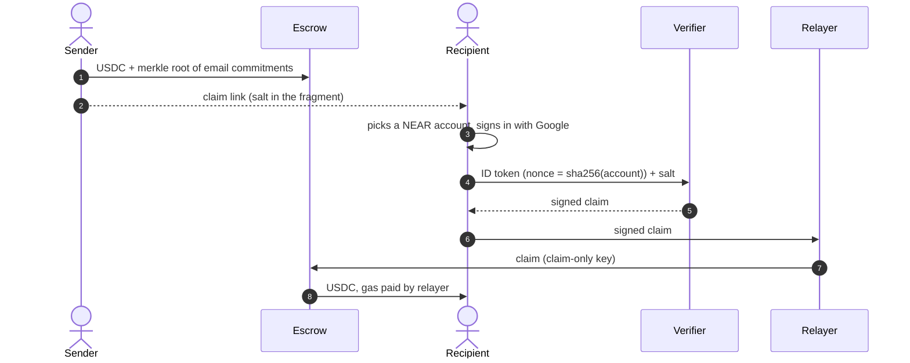

<h1 align="center">Zarf on NEAR</h1>

<div align="center">

**Send USDC to any Google email. They sign in to collect it.**

Live now on NEAR testnet at **[near.zarf.to](https://near.zarf.to)**, for teams paying freelancers and
contributors in USDC. Built 7–14 Nov 2026 for the NEAR Hackathon, Real-World Money track.

**[Try it with your Gmail →](https://near.zarf.to/try)**

<a href="https://near.zarf.to/try"></a>

</div>

**One payment, many emails — no wallet address to collect, no gas to claim, no seed phrase.**

**A Zarf link pays the person, not the forwarder.** A Linkdrop pays whoever holds the link; a forwarded
Zarf link still requires the intended recipient's Google sign-in (Gmail or Google Workspace). Our verifier
checks that sign-in and signs the claim; the NEAR contract checks the signature, then pays. Emails never
touch the chain.

| Try it | See it on chain | Check the escrow |
| --- | --- | --- |
| Get 0.5 test USDC for your Gmail at **[near.zarf.to/try](https://near.zarf.to/try)** and claim it with Google, into your NEAR account or a new one made with Face ID. The relayer pays gas. | A real Google sign-in on near.zarf.to; the escrow paid 0.5 test USDC: **[tx AY7GFZSL…](https://testnet.nearblocks.io/txns/AY7GFZSLZa5R26YTAUyUWA6uTBMJ9MAcmBaZkjnFMa2F)**. More in [Proof](#proof). | The escrow holds the USDC and has **no access keys at all**; its code changes only through a public, delayed upgrade. **[zarf-near-1112.testnet](https://testnet.nearblocks.io/address/zarf-near-1112.testnet)** |

**Reading the code, or sending an agent to read it?** Start at [`spec/claim.md`](spec/claim.md), the byte-exact claim
format. The money is enforced in [`contract/src/lib.rs`](contract/src/lib.rs), the Google check is in
[`verifier/src/`](verifier/src), and the gas-paying relayer is in [`relayer/src/`](relayer/src). `make test`
runs every suite.

## The story

*Ayşe and Lena are an illustrative example.*

Ayşe runs a small design studio in Istanbul and pays freelancers in four countries. Paying one of them
in USDC always starts with the same question: "What's your wallet address?" Lena, an illustrator in
Lisbon, doesn't have one. She has a Gmail account.

So Ayşe pastes her freelancers' email addresses into Zarf and pays the USDC once, from her wallet, for the
whole list. Lena gets a private claim link, creates a NEAR account with Face ID on testnet,
then signs in with Google. She pays no network fee and writes down
no seed phrase. After the deadline, Ayşe can reclaim anything left unclaimed.

Ayşe never asks anyone for a wallet address again.

## How it works

<picture>
  <source media="(prefers-color-scheme: dark)" srcset="docs/media/how-it-works-dark.webp">
  
</picture>



The chain records salted commitments, amounts, campaign roots, senders and claim destinations; email
addresses stay off chain.

## Why NEAR

Google identity is checked off chain by our verifier; everything that holds or moves the USDC is enforced on
NEAR:

| NEAR feature | What it gives a recipient or sender |
| --- | --- |
| **Function-call access key limited to `claim`** | The relayer pays the recipient's gas with a key restricted to `claim`; the contract enforces the verifier-signed amount and destination (`relayer/`, `scripts/deploy.sh`). |
| **Keyless account** | The escrow holds zero access keys; its code changes only through a public, delayed upgrade (10 min on testnet). |
| **NEP-141 + NEP-145 storage registration** | The recipient needs no token setup: `claim` registers them (`storage_deposit`) and pays (`ft_transfer`). |
| **Storage staking** | The sender pre-pays storage for every claim (`prepay_deposit`), and what is unused goes back on `reclaim` or `prepay_withdraw`. |
| **Promise callbacks** | `on_claim` marks a successful transfer claimed and returns a failed transfer to unclaimed; if the callback itself fails, the owner settles the claim after 1 h (`resolve_pending`). |
| **Any NEAR account, any wallet** | Named, implicit or NEP-518 `0x` accounts (a `0x` payout was spent with its Ethereum key, see [Proof](#proof)); senders connect through NEAR Connect (Meteor, Intear, Nightly, MetaMask through Ethereum Wallets). |
| **NEAR Intents, ten chains** | **For the mainnet launch:** fund a send with USDC from another chain, or pay out on Base, Arbitrum, Ethereum, Optimism, Polygon, Avalanche, Monad, Solana, Sui or Aptos. Testnet shows the live quotes; payouts turn on at launch (`verifier/src/intents.ts`, `web/src/lib/chains.ts`). |

**No wallet?** On testnet, the claim page creates the NEAR account: Face ID or Touch ID, passkey PRF, a key
held in page memory, and a backup key file (`web/src/lib/passkey.ts`).

<details>
<summary><b>What is in the repo</b>: spec, contract, verifier, relayer, apps, judges' page, watcher, proxy, mailer</summary>

| Part | Path | What it does |
| --- | --- | --- |
| Spec | `spec/` | Byte-exact claim format (`claim.md`) and the shared test vectors (`vectors.json`) every layer reproduces |
| Contract | `contract/` | NEP-141 escrow (Rust, near-sdk 5.26.1): campaigns keyed by (sender, merkle_root), merkle-checked claims signed by a registered verifier key, pending/in-flight accounting with a callback restricted to calls from the escrow itself, reclaim after the deadline, the owner's `resolve_pending`. Tests in `contract/` (see Run it and `contract/README.md`) |
| Verifier | `verifier/` | Cloudflare Worker: Google ID token (RS256, JWKS, aud/iss/exp/email_verified, nonce = hex(sha256(destination))), HMAC commitment, merkle proof, chain checks, ed25519 signature |
| Relayer | `relayer/` | Cloudflare Worker: checks the merkle proof against the campaign root, then submits verifier-signed `claim` calls with a claim-only function-call key; payout status from the contract's events |
| Create app | `web/src/routes/create` | CSV → salts, commitments, tree; storage pre-pay + one `ft_transfer_call`; claim links carrying each recipient's salt, amount and merkle proof (nothing else is published) |
| Claim app | `web/src/routes/claim` | Destination: an existing NEAR account, checked on chain before sign-in; on testnet also a new account with Face ID or a key file. `0x` destinations behind a config switch (`PUBLIC_ETH_ACCOUNTS`). Cross-chain payout through NEAR Intents to USDC on ten chains (NEAR Intents 1Click; testnet shows live quotes, payouts start at the mainnet launch). Then Google sign-in, verifier → relayer; the receipt trusts the relayer's event-based 200 (`claim_paid`) and polls `claim_state` only on a 202; pending claims and cross-chain steps survive a reload |
| Judges' page | `faucet/` | Cloudflare Worker behind `/try`: Turnstile, atomic per-IP/per-email/daily counters, then a one-recipient test-USDC campaign and its claim link |
| Watcher | `watcher/` | Cron Worker: runs every 2 min and alerts on detected upgrade proposals, owner or verifier-key changes, changes to the escrow's code hash or access keys, and changes to the live claim page (`watcher/README.md`) |
| Proxy | `proxy/` | `near.zarf.to`: passes `/try` (with its script, font and API) and `/health` to the judges' page, everything else to the claim app |
| Mailer | `mailer/` | Email All Recipients: emails each recipient their claim link through Resend, only for a leaf whose merkle proof reaches a live, funded, unclaimed campaign on chain; one mail per commitment, capped per campaign, per day and per sender; stores commitments only |

Deployment history and RPC verification commands: `docs/deploy/testnet.md`.

</details>

## How trust works

- **The verifier checks the Google sign-in and signs each claim.** Trion Labs runs it as a Cloudflare
  Worker, and the contract owner registers its signing key. It sees the email at claim time and never stores
  it. Each campaign accepts only the verifier keys registered when it was created. The owner can revoke one immediately with
  `remove_agent`, and the watcher alerts on registry changes.
- **The chain never sees an email.** Per recipient it stores `commitment = HMAC-SHA256(salt, canonical email)`
  and the amount (`spec/claim.md`).
- **Upgrades are public and delayed.** The owner proposes a code hash on chain and applies it after
  `upgrade_delay_ns`. The watcher checks every 2 min and alerts on proposals. The owner or a configured
  guardian can cancel a proposal before the upgrade starts.
- **The relayer pays the claim's gas.** Its claim key can call only `claim`, with no deposit, and it submits
  only claims our verifier signed. The destination is inside that signature, so the relayer cannot redirect
  funds.
- **The sender can reclaim unclaimed funds** after the campaign deadline using `reclaim`.

<details>
<summary>Every trust detail</summary>

- **The verifier's checks.** At claim time it checks the Google ID token and the recipient's salt against
  the commitment, then signs. The commitment and amount become public when the claim is submitted on chain.
- **Upgrade window and guardian.** On mainnet `new` refuses an `upgrade_delay_ns` outside 10 min to 1 h, and
  `scripts/deploy.sh` requires a guardian and an offline backup verifier key; on mainnet the owner will hold
  the guardian in a separate account. The watcher also alerts on an owner change, a verifier-key change, a claim
  page that differs from what was deployed, and, read from the protocol rather than the contract's own
  views, an escrow code hash other than the expected one or any access key on the escrow.
- **The escrow account has no full-access key.** Every full-access key is deleted after deploy and `new`
  (`spec/claim.md`, "Upgrades and ownership"), so nobody can sign as the escrow and move its tokens. On
  testnet `zarf-near-1112.testnet` holds no access key at all.
- **Each campaign snapshots its accepted keys at creation.** A claim requires a snapshotted signer whose
  registry entry remains valid; `remove_agent` revokes that entry immediately.
- **The owner settles a stuck claim.** `resolve_pending` settles a claim that has stayed `pending` for an
  hour, as paid or as unpaid. USDC is pooled per token in the escrow, so the answer moves that pool: a claim
  settled as unpaid can be claimed again from it (`settle` in `contract/src/lib.rs`).
- **The salt is in the claim link's fragment** (`#s=<salt>&a=<amount>&p=<proof>`), which the claim site's
  server never receives. At claim time it goes only to the verifier, which never logs it. If the sender uses
  Email All Recipients, the mailer (`mailer/`) and Resend, our email provider, also see each address and its
  link; the mailer stores only the commitment. The sender's recovery file and link list hold every salt.
  Claiming with a link needs the Google account it was sent to.
- **Relayer details.** Gas is spent only after a valid verifier signature and a merkle proof checked against
  the campaign root; a wrong proof is refused before a transaction. Per-IP rate limits on the verifier and
  relayer shed noise. `claim` is permissionless: anyone holding the verifier's signed arguments can
  submit them, so the relayer is a convenience, not a trust point. We do not use NEP-366 meta-transactions:
  they need the recipient to sign a delegate action with their own NEAR key, and a recipient here proves who
  they are with Google, possibly with no NEAR account at all.
- **On mainnet, cross-chain payouts use NEAR Intents 1Click.** The destination address and the amount go to
  1Click, which pays out from a one-time deposit address whose status is public, so the claim can be linked
  to the destination address. Payout assets are pinned to Circle USDC on ten chains, each as a NEAR-side
  token from one of three bridge issuers: `omft.near` (Base, Arbitrum, Ethereum, Solana, Sui, Aptos),
  `omdep.near` (Polygon, Avalanche) and HOT Omni `v2_1.omni.hot.tg` (Optimism, Monad)
  (`web/src/lib/chains.ts`); the same list serves funding a send. For a payout requested through the claim
  page, the verifier requires a quoted minimum output of at least 98% of the amount, a payout of at most
  1,000 USDC, and refunds directed to the campaign sender. The 98% floor caps the bridge's fee at 2%;
  a claim to a NEAR account has no bridge check. If the bridge does not complete the payout by its
  deadline, it refunds the campaign sender on NEAR. A FAILED payout does not pay the recipient; the page
  tells them to contact the sender, who can follow it up with NEAR Intents support using the deposit address.
- **Wallets run their own code.** The send pages connect through NEAR Connect with a
  pinned list of wallets (Meteor, Intear, Nightly; HOT on mainnet). Each wallet's code runs in a sandboxed
  iframe that cannot read the page. The code from GitHub is pinned to a commit; Intear serves its own, pinned
  by SHA-256 (`integrity` in wallets.json, checked by `web/patches/@hot-labs__near-connect@0.12.0.patch`):
  when Intear ships a new file, Intear stops opening until someone reads it and updates the hash. The
  wallet's own approval screen, which shows the receiver and amount, is the last check before signing. The
  claim page uses the same list only to read the recipient's account name ("Use my wallet"), never to sign,
  and the recipient confirms that name before Google sign-in. The send pages, and the claim form with `0x`
  accounts on, also offer Ethereum Wallets (MetaMask): its executor script from evm-on-near.dev is pinned by
  SHA-256 like Intear's; a MetaMask sender signs in evm-on-near.dev's own popup and confirms on MetaMask's
  screen.
- **Face ID accounts are created in the claim page** (testnet). With passkey PRF support, the key is
  re-derived from the site-bound passkey and held in page memory, with a key file for backup. Otherwise, Zarf
  generates a random key, and the key file provides recovery.
- **USDC is Circle's.** Circle's pause and block rules apply to claims and reclaims too.
- **At mainnet launch, the app caps a send at 100 USDC**; the contract itself has no cap.
- **Storage is pre-paid by the sender** in NEAR (`prepay_deposit`): the campaign entry plus storage for each
  claim. The unused reservation returns to the sender's free pre-pay on `reclaim`, and `prepay_withdraw`
  sends free pre-pay back to the sender.
- **Accounts.** On testnet the claim page creates the NEAR account (Face ID or key file); on mainnet the
  recipient brings one.
- **Starter NEAR on testnet.** After a claim returns HTTP 200 (`paid`), the relayer attempts a one-time 0.02
  test NEAR top-up for a destination holding under 0.005 NEAR, including new implicit or `0x` accounts. A
  separate gas account with its own key funds it, with at most 50 attempts a day. A confirmation that arrives
  after the initial response is followed durably, and a failed top-up remains eligible for a bounded retry
  (`relayer/src/starter.ts`).
- **Gas.** Gas for the claim itself is the relayer's: the contract requires 55 Tgas attached
  (`required_claim_gas`), and a claim measured about 11.6 Tgas burnt.

</details>

## Proof

| What we show | Evidence |
| --- | --- |
| A judges' page claim paid 0.5 test USDC after a real Google sign-in on the hosted app | tx [`AY7GFZSL…`](https://testnet.nearblocks.io/txns/AY7GFZSLZa5R26YTAUyUWA6uTBMJ9MAcmBaZkjnFMa2F) campaign 2, 0.5 test USDC paid, events `claim_started` and `claim_paid` |
| A NEP-518 `0x` account received a payout and spent it with its Ethereum key | [payout](https://testnet.nearblocks.io/txns/2Zi796Z4k87JPLkgt8Dtsu1iZxhThtVcj4dPUCCNgRtJ), [spend](https://testnet.nearblocks.io/txns/FkRvT7Wt77DwWpgosZJ7EG31rfFSJbKW6voxCW4MAafe) |
| Every layer agrees on the bytes of commitments, leaves, nonces and signed payloads | [shared vectors](spec/vectors.json); [verifier bytes](verifier/test/claim.test.ts); [verifier flow](verifier/test/claimFlow.test.ts); [create app](web/src/lib/create/create.test.ts); [merkle tree](web/src/lib/merkle.test.ts); [contract tests](contract/src/tests.rs) (`leaves_match_vectors`, `payload_rebuilt_from_args_matches_vectors`, `every_invalid_vector_fails_with_its_code`) |
| A Google sign-in only pays the destination chosen before it | [Google token checks](verifier/test/googleIdToken.test.ts) (`BAD_NONCE`), [destination nonce tests](web/src/lib/claim.test.ts) |
| A claim requires the intended recipient's Google sign-in and the matching claim link | [recipient binding tests](verifier/test/claimFlow.test.ts) (`COMMITMENT_MISMATCH`) |
| The relayer's claim key can call only `claim`, with no deposit; the relayer refuses claims our verifier did not sign | [relay policy tests](relayer/test/relay.test.ts), [transaction encoding tests](relayer/test/near.test.ts) (bytes checked against `@near-js/transactions`) |
| Reliability is tested: a bad proof costs no gas, a settling claim survives a reload, a late starter transfer is retried, and concurrent faucet requests cannot pass the daily cap | [relay](relayer/test/relay.test.ts) (invalid proof refused before gas), [claim recovery](web/src/lib/claim-recovery.test.ts) (still-settling claim kept), [starter](relayer/test/starter.test.ts) (failed top-up retried), [quota](faucet/test/quota.test.ts) (lost reserve retried), [SQLite quota](faucet/test/quota-runtime.test.ts) (cap holds across restart) |

<details>
<summary>All evidence</summary>

| What we show | Evidence |
| --- | --- |
| The verifier also produces the same signatures inside Cloudflare's runtime | [`verifier/test/workerd.test.ts`](verifier/test/workerd.test.ts) |
| Before signing, the verifier checks: the Google token and the destination; that the campaign exists and its deadline has not passed; that the commitment is neither claimed nor pending; HMAC(salt, email) = commitment; the merkle proof against the on-chain root; that its key is in the campaign snapshot and its registry entry outlives the signature; that the balance covers the amount. The contract's storage (E128) and gas (E130) checks run on chain | [`verifier/test/claimFlow.test.ts`](verifier/test/claimFlow.test.ts) |
| No email or salt goes on chain; a claim link whose proof does not rebuild the on-chain root is refused before sign-in (`LINK_MISMATCH`) | [`spec/claim.md`](spec/claim.md); [`web/src/lib/merkle.test.ts`](web/src/lib/merkle.test.ts) (`rootFromProof`), [`web/src/lib/claim.test.ts`](web/src/lib/claim.test.ts) (link vectors) |
| A reverted transfer is never shown as paid | [`relayer/test/relay.test.ts`](relayer/test/relay.test.ts) (`claim_reverted`), [`web/src/lib/services.test.ts`](web/src/lib/services.test.ts) (`settleClaim`) |
| A draft can be funded at most once: (sender, merkle_root) is an idempotency key (E132), and after a lost wallet response the app checks `campaign_by_root` before any resend | [`web/src/lib/create/create.test.ts`](web/src/lib/create/create.test.ts) (`fundCampaign`, `resolveByRoot`, `mayCreate`); [`contract/src/tests.rs`](contract/src/tests.rs) (`duplicate_root_is_e132_and_changes_nothing`) |
| A claim whose callback fails stays pending until the owner's `resolve_pending` (after 1 h); `reclaim` never touches in-flight funds | [`contract/src/tests.rs`](contract/src/tests.rs) (`callback_failure_restores_claim_but_not_storage_debit`, `reclaim_excludes_in_flight_and_reverts_on_failed_transfer`, `resolve_pending_is_owner_only_and_waits_an_hour`); [`contract/integration/tests/escrow.rs`](contract/integration/tests/escrow.rs) (`failed_callback_strands_claim_until_owner_resolves_it`) |
| The live 0.1.2 contract on testnet paid a claim and refused a repeat | claim `Cmi5X9XyiQjSfhJDahWz6TvZKSjkVX5MKjFqAYS7m7Zt`; repeat `FLmmkbCQckFQWK9CEKxmxrtMrf2XLB28qR2guPnk6RFL` → `E105` |

Check the Google claim from a terminal:

```sh
curl -s https://archival-rpc.testnet.fastnear.com -H 'Content-Type: application/json' \
  -d '{"jsonrpc":"2.0","id":1,"method":"tx","params":{"tx_hash":"AY7GFZSLZa5R26YTAUyUWA6uTBMJ9MAcmBaZkjnFMa2F","sender_account_id":"zarf-near-relayer-1111.testnet"}}'
```

</details>

## Run it

Runs locally with no secrets or Google login. Prerequisites: `git`, `make`, Node 24 and pnpm 10.30.3 (pinned as
`packageManager`; with Node 24, `corepack enable` once provides it).

```sh
make test  # all suites, including contract tests with Rust installed
make demo  # local claim flow: generated sign-in token, mocked NEAR RPC
```

The contract has 71 unit tests and 11 near-workspaces integration tests (9 sandbox scenarios, 2 release-Wasm
checks), and every layer reproduces `spec/vectors.json` byte
for byte. `make test` ends with one summary line; with the Rust toolchain installed:

```text
SUMMARY: verifier ✓ relayer ✓ web ✓ watcher ✓ scripts ✓ proxy ✓ mailer ✓ faucet ✓ contract ✓
```

<details>
<summary>Contract tests, the demo and the sandbox</summary>

`make install` is optional: test and demo install what they need themselves; `pnpm install` needs network
access.

`make test` runs the contract's tests (`contract/Makefile`: unit, then near-workspaces integration) when
`cargo` is installed; without it the summary reports the contract suite as skipped. It runs every suite and
exits 1 if any that ran failed. The contract suites also need
`rustup`, `cargo-near`, a C compiler and `perl` (the integration crate builds OpenSSL from source). rustup
installs the pinned toolchains (1.86.0 for the contract, 1.95.0 for the integration tests) and the wasm
target from each `rust-toolchain.toml`. The unit suite (71 tests) and the near-workspaces integration suite
(11 tests) pass; the integration step takes about 2-3 min including the wasm builds (the tests create the
contract with a 30 s `resolve_delay_ns`, so the stranded-claim test does not wait the 1 h used on testnet and
mainnet).

`make demo` starts the verifier and the relayer locally and plays one recipient's claim: a sign-in token,
the verifier's checks and signature, the relayer's `claim` transaction, then it asserts
`claim_state == "claimed"`. The demo verifier is a separate build (`verifier/src/demo.ts`): its token
issuer is generated in memory instead of Google, and the release build does not include it
(`verifier/test/demo.test.ts`).

- `make demo` runs `--dry`: a mocked NEAR RPC stands in for the chain. It still checks what the chain would
  (the relayer's transaction signature, the verifier's signature, the merkle proof), so the TypeScript side
  runs end to end; the output says the contract is mocked.
- `make demo-sandbox` runs the same claim against a local NEAR sandbox with the real contract deployed and a
  campaign seeded (`scripts/demo-sandbox.sh`). It needs the Rust toolchain above; the first run compiles the
  contracts once (about 15 minutes) and later runs are fast. The demo verifier signs, the relayer submits,
  the real contract pays out, and `claim_state` reads `claimed`. This path always uses the real contract.
- The sandbox demo signs with the public test keys in `spec/vectors.json`; mainnet and `scripts/deploy.sh`
  refuse them.

</details>

## Reliability

- **Wrong proofs cost no gas.** The relayer recomputes the merkle proof against the campaign root before it
  submits; a resent approval with a wrong proof is refused locally (`relayer/src/relay.ts`,
  `relayer/test/relay.test.ts`).
- **A settling claim survives a reload.** The claim page keeps a pending claim and each cross-chain recovery
  step in the browser, restores them without resubmitting, and settles a recovered payment from claim state
  and payout events rather than the old tab's memory (`web/src/lib/claim-recovery.ts`,
  `web/src/lib/ClaimRecord.svelte`, `web/src/lib/claim-recovery.test.ts`).
- **Starter NEAR follows late confirmations.** After a claim confirms, the relayer durably follows the one-time
  starter transfer; a failed top-up remains eligible for a bounded retry, with one send per claim
  (`relayer/src/starter.ts`, `relayer/test/starter.test.ts`).
- **The judges' page quota is atomic.** Per-IP, per-email and daily counters reserve and commit in one Durable
  Object transaction; stable ids and bounded retries make a lost write retry without double-spending a slot
  (`faucet/src/quota.ts`, `faucet/src/limits.ts`, `faucet/test/quota.test.ts`).

## Roadmap

- Mainnet launch, with funding and payouts in USDC on [ten chains](web/src/lib/chains.ts) through NEAR Intents 1Click (live quotes already show on the testnet send page).
- TEE-attested verifier: the signing key registered through on-chain attestation.
- NEAR Auth (FastAuth): a mainnet NEAR account at claim time for recipients without one, in place of the testnet
  Face ID account.

## Prior work, baseline and libraries

Prior work: **Zarf on Stellar, same team, interface reused.** The NEAR escrow, verifier, relayer and
NEAR-specific app logic are new; the web interface is adapted from Zarf on Stellar. The build window
runs from the first commit on 2026-11-07 through the final submission tag:
[hackathon-submission](https://github.com/yamancan/zarf-on-near/tree/hackathon-submission).

<details>
<summary>Baseline files and libraries</summary>

**Baseline: the interface predates the build window.** The web apps reuse Zarf's interface, design system
and create/recipient components from Zarf on Stellar (2026-10-14), adapted for NEAR. These files are not
hackathon work:

| Path here | From Zarf on Stellar |
| --- | --- |
| `web/src/lib/zen/**` | The Zen UI kit: components (ZenButton, ZenCard, ZenInput, ZenSelect, ZenCheckbox, ZenAlert, ZenBadge, PageHeader, ThemeToggle, ZarfLogo), theme store, colour, spacing, motion, radius and shadow tokens, light and dark themes |
| `web/src/app.css` | The ripple background, the dark ground and the landing grain |
| `web/src/lib/{Amount,Hero,Medallion,Note,ZarfMark}.svelte`, `web/src/routes/+layout.svelte` | The claim card's amount block, the landing hero, the status medallion and line, the logo mark, the navbar: markup and classes adapted |
| `web/src/lib/zarf-kit/**` | Zarf's UI kit (`web/packages/ui/lib`) and the create app's recipient grid, import controls and row checks (`apps/create/src/lib/components/recipients`), copied as they are; each change is listed in `web/src/lib/zarf-kit/README.md` (NEAR's own row checks are in `web/src/lib/create/grid.ts`) |
| `web/static/favicon.svg`, `web/static/og.png`, `faucet/src/assets.ts` (favicon) | Brand assets |

Third-party assets: the Saira font (`web/static/fonts`, SIL OFL, licence beside it) and Google's sign-in
button and Gmail mark (`web/static/google`, used as Google's branding guidelines allow).

**Libraries.**

| Where | Library | Use |
| --- | --- | --- |
| verifier | none at runtime (Web Crypto) | RS256, HMAC, SHA-256, ed25519 |
| relayer | none at runtime (Web Crypto) | NEAR transaction encoding and signing are written here |
| relayer (tests only) | `@near-js/transactions` 2.5.1, `@near-js/crypto` 2.5.1 | reference implementation the transaction bytes are checked against |
| web | `@sveltejs/kit`, `svelte`, `vite`, `@sveltejs/adapter-cloudflare` | apps |
| web (claim, cross-chain step) | `@noble/hashes` 1.8.0 | keccak-256 for the EIP-55 address checksum |
| web (send, fund from another chain) | `uqr` 0.1.3 (MIT) | the deposit address as a QR code |
| web (send pages; claim form reads the account only) | `@hot-labs/near-connect` 0.12.0, with a pinned wallet list (Meteor, Intear, Nightly; HOT on mainnet; Ethereum Wallets on the claim form with 0x on) | sender wallet: NEAR Connect, NEAR's replacement for the deprecated wallet selector |
| all | `typescript`, `vitest`, `wrangler`, `svelte-check` | build and tests |
| contract | `near-sdk` 5.26.1 (Rust 1.86.0) | the escrow; built with `cargo-near` |
| contract (tests only) | `near-workspaces` 0.24.0 (Rust 1.95.0), `near-contract-standards` 5.26.1 (the test-only `mock-ft`), `tokio`, `ed25519-dalek` 2, `sha2` 0.10 | sandbox integration tests and a test-only `mock-ft` token |
| verifier (tests only) | `@types/node` 24 | builds the release and demo bundles in a test, to check what each contains |

AI assistance: this code was written with Claude Code agents (implementation and review), with humans
deciding design and scope.

</details>

## Tracks

Real-World Money (primary), Open Innovation.

## License

PolyForm Noncommercial 1.0.0: free for noncommercial use; commercial use needs a license from Trion Labs.

Deployment records and RPC checks: [docs/deploy/testnet.md](docs/deploy/testnet.md).
